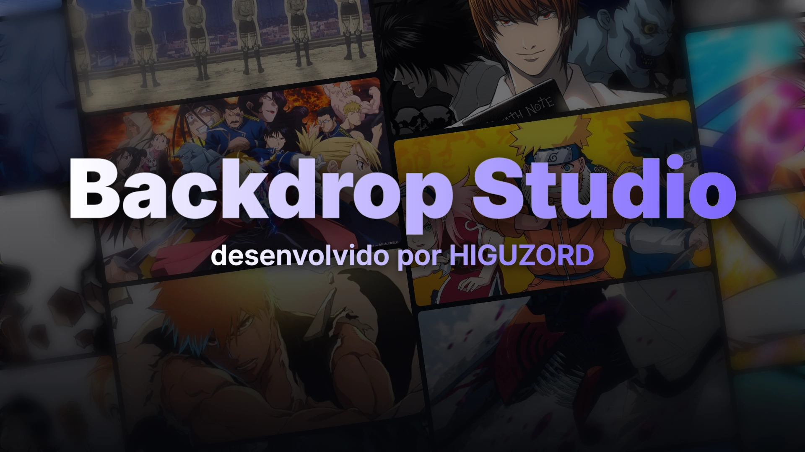
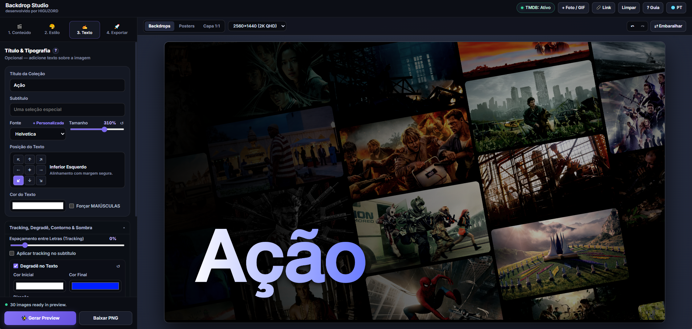
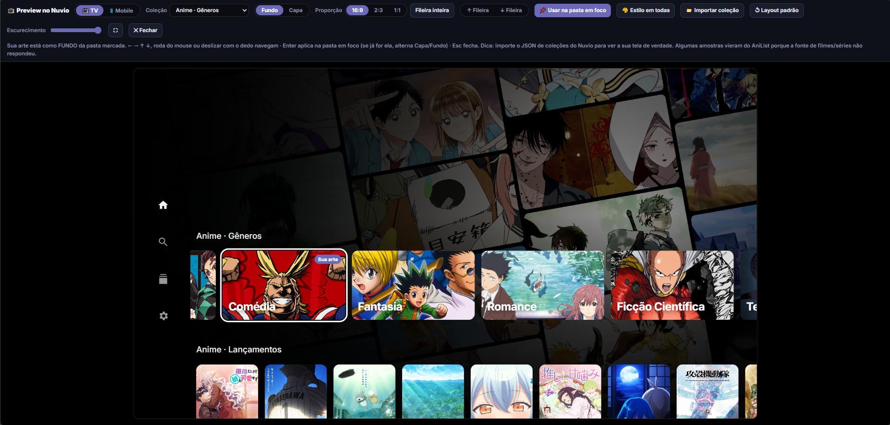

 

> A complete, dependency-free web studio for creating custom **Backdrops (16:9)**, **Posters (2:3)**, and **Square Covers (1:1)** for streaming catalogs, media centers, Nuvio, and more.

---

## ✨ Overview

**Backdrop Studio** brings together metadata search, advanced visual composition, individual poster editing directly on the canvas, and batch export in a **single HTML file** — no installation, server, or build process required.

It integrates natively with the **AniList** and **TMDB** APIs, and can also import `.json` files from **AIOMetadata** to generate artwork for dozens of catalogs at once in a single `.zip` file.

---

# Backdrop Studio

You can use the tool online with the button below.

To run it locally, download the `.html` file using the link below.

[📥 Download the latest version](https://github.com/higuzord/backdrop-studio/releases/latest)

Brazilian community for Nuvio and Stremio

---

## 🚀 Features

🎬 **Multiple sources:** integration with AniList, TMDB, direct links, and AIOMetadata catalog imports.

🎨 **Ready-made styles:** several presets to create compositions quickly.

🖼️ **Customizable layouts:** mural, grid, diagonal, strips, and collage.

✍️ **Text customization:** fonts, colors, shadows, outlines, and other effects.

🎛️ **Individual editing:** adjust poster position, zoom, and arrangement.

📦 **Batch export:** generate multiple catalogs at once in a ZIP file.

💾 **High-resolution export:** save as PNG, WebP, and GIF.

🌎 **Multilingual:** interface available in Portuguese and English.

📱 **Mobile-friendly:** compatible with mobile devices.

📺 **Preview:** see how your cover or backdrop will look in Nuvio without exporting it first.

---

## ⌨️ Shortcuts & Quick Gestures

| Action | Desktop | Mobile / Touch |
| :--- | :--- | :--- |
| **Select a poster** | Click the poster | Tap the poster |
| **Adjust poster framing** | Drag over the poster | Drag with 1 finger |
| **Zoom in/out on a poster** | Mouse wheel over the poster | Pinch with 2 fingers |
| **Move the entire composition** | `Shift` + Drag (or drag the background) | Drag the background |
| **Zoom the entire composition** | `Shift` + Mouse wheel | Pinch with 2 fingers (when no poster is selected) |
| **Swap two posters** | `Ctrl` / `Cmd` + Drag onto another poster | Enable the `⇄ Swap` button and drag |
| **Remove the selected poster** | `Delete` key | `Remove` button in the editor |
| **Undo and redo** | `CTRL + Z` / `CTRL + Y` | `↶` / `↷` buttons in the editor |

---

## 📖 How to Use

1. Open the tool using the **Open Tool** button, or download the `.html` file to run it locally.
2. Choose content using AniList, TMDB, AIOMetadata, or individual search.
3. Select a visual style and customize your composition.
4. Adjust the posters and add text if you want.
5. Export your artwork as PNG, WebP, or GIF.

---

## 🔑 Requirements

To use TMDB features, you need to configure a free TMDB token or API key.

AniList features do not require an API key.

For batch export, import an AIOMetadata JSON file.

The Nuvio preview uses a generic collection by default, but you can import your own collection from a JSON file.

---

## 👤 Credits

Developed by **HIGUZORD**.
