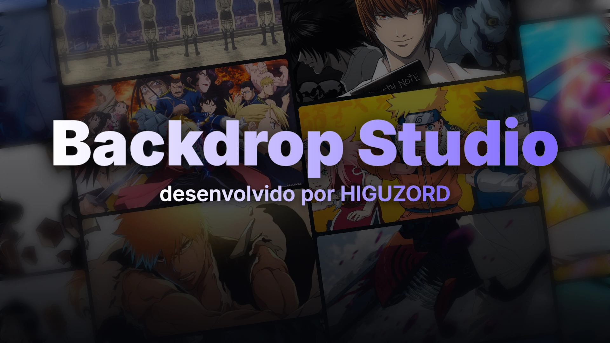

> Estúdio web completo e sem dependências para criar **Backdrops (16:9)**, **Posters (2:3)** e **Capas Quadradas (1:1)** personalizados para catálogos de streaming, media centers (como Nuvio) e etc.

---

## ✨ Visão Geral

O **Backdrop Studio** reúne busca de metadados, composição visual avançada, edição individual de cartazes diretamente no canvas e exportação em lote em um **único arquivo HTML** — sem necessidade de instalação, servidor ou build.

Ele se integra nativamente às APIs do **AniList** e do **TMDB**, além de importar arquivos `.json` do **AIOMetadata** para gerar capas de dezenas de catálogos de uma só vez em um arquivo `.zip`.

---

# Backdrop Studio

Você pode rodar a ferramenta online no botão abaixo.

Se quiser rodar localmente você pode baixar o arquivo.html no link abaixo

[📥 Baixar última versão](https://github.com/higuzord/nuvio-backdrop-studio/releases/latest)

Comunidade BR sobre Nuvio e Stremio

---

## 🚀 Principais Funcionalidades

### 1. Fontes de Conteúdo & Presets
* **10 Presets Visuais Prontos:** Aplique estilos completos com apenas 1 clique. Se o preview estiver vazio, a arte é gerada na hora.
* **Feeds Rápidos (AniList):** Preenchimento instantâneo com *Animes em Alta*, *Mais Populares*, *Melhores Notas* ou *Lançamentos*.
* **Explorador Avançado (AniList & TMDB):**
  * Busca por palavra-chave ou título, múltiplos gêneros, formato (*TV, Filme, OVA, ONA, Especial*), ordenação e quantidade de itens (de `1` capa até `40` itens).
  * **Filtros Avançados:** Autocomplete completo de **Tags do AniList** (carregadas dinamicamente da API), filtro por **Década** (1970–2020), **Ano específico**, **Temporada** (*Inverno, Primavera, Verão, Outono*) e opção para incluir conteúdo adulto (`+18`).
  * Remoção automática de obras duplicadas.
* **Integração com AIOMetadata (`.json`):**
  * Importa o arquivo de configuração `.json` do AIOMetadata e lista todos os catálogos disponíveis (ignorando catálogos mesclados).
  * Filtro por nome e chips automáticos por provedor/tag (`AniList`, `TMDB`, tags personalizadas).
  * Clique em qualquer catálogo para visualizar na hora ou marque vários para exportar em lote.
* **Busca Individual & Fotos Locais:**
  * Pesquise qualquer anime, filme ou série para substituir um cartaz selecionado, adicionar em posição aleatória ou definir como capa única.
  * Suporte para upload de imagens locais (`+ Foto Local`) direto do dispositivo.

### 2. Integração Inteligente com TMDB (Posters com Logo)
* Configuração opcional de colocar sua **Read Access Token (v4)** ou **API Key (v3)** pra puxar posters do TMDB, ela é salva localmente no navegador, com validador integrado e escolha de idioma preferido (`pt-BR`, `en-US`, `ja-JP`).
* **⚡ Poster TMDB / ⚡ Todos TMDB:** Substitui um cartaz específico ou toda a composição pelos **posters oficiais com logo** no idioma escolhido.
* **🎬 Galeria TMDB:** Abre um seletor visual com todos os *Posters* e *Backdrops* disponíveis para a obra, identificando quais possuem logo por idioma ou são limpos (`SEM TEXTO`).

### 3. Estilos, Layouts & Atmosfera
* **3 Modos de Proporção (com resoluções até 4K):**
  * **Backdrops (16:9):** `1280×720`, `1920×1080` (Full HD), `2560×1440` (2K QHD) e `3840×2160` (4K UHD).
  * **Posters (2:3):** `1000×1500`, `1400×2100` e `2000×3000`.
  * **Capa 1:1 (Quadrada):** `1080×1080`, `1500×1500` e `2048×2048`.
* **6 Disposições de Layout:**
  * `Mural Inclinado` (colunas alternadas com desalinhamento ajustável)
  * `1 Poster Destaque` (ativado automaticamente ao carregar apenas 1 obra)
  * `Grade Uniforme`
  * `Painéis Diagonais`
  * `Faixas Paralelas`
  * `Cartazes Soltos` (colagem orgânica com sombra projetada)
* **Controle de Geometria & Enquadramento:**
  * Alternância global ou individual entre **Banners** e **Posters**.
  * Ajustes de inclinação (`-45°` a `+45°`), espaçamento, arredondamento de cantos, número de colunas, desalinhamento, opacidade, cor de fundo e **Zoom/Posição Global** do conjunto.
* **Filtros Visuais & Efeitos de Pós-Processamento:**
  * **8 Filtros Prontos:** *Normal*, *Cinema Dramático*, *Cyberpunk / Neon*, *Preto & Branco*, *Noir Alto Contraste*, *Sépia Clássico*, *Vintage Quente* e *Suave / Etéreo*.
  * Ajustes finos de brilho, contraste, saturação, escurecimento, degradê/vinheta, **Desfoque Localizado** (vinheta ou direcional com controle de alcance e suavidade) e **Tintura de Cor (Tint)** com modos *Duotone*, *Multiplicar*, *Luz Suave* e *Sobrepor*.
  * Botões individuais de reset (`↺`) em cada controle.

### 4. Editor Interativo Direto no Canvas
Clique em qualquer cartaz no preview para abrir o painel de edição individual:
* **Enquadramento Livre:** Arraste o cartaz para reposicionar e use a roda do mouse (ou pinça no celular) para aplicar zoom (`1.00x` a `2.60x`).
* **🎲 Trocar Aleatório (Filtro):** Sorteia outra obra inédita respeitando os filtros ativos do *Explorar* ou do catálogo atual do *AIOMetadata*.
* **⇄ Trocar Lugar:** Reordene cartazes arrastando um sobre o outro (segurando `Ctrl` no desktop ou ativando o modo *Trocar Lugar* no mobile).
* **Embaralhar & Restaurar:** Embaralhe a ordem de todos os cartazes em 1 clique (`⇄ Embaralhar`), substitua por foto local ou restaure a arte original.

### 5. Tipografia & Título Opcional
* Adicione **Título** e **Subtítulo** (com ajuste automático de escala para nunca ultrapassar as margens).
* **7 Fontes:** *Inter*, *Helvetica*, *Anton*, *Bebas Neue*, *Montserrat*, *Oswald* e *Cinzel* ou adicione sua fonte personalizada.
* **Grade de Alinhamento de 9 Posições** (`↖ ↑ ↗ ← ✦ → ↙ ↓ ↘`) com margem segura.
* Efeitos avançados: espaçamento entre letras (**Tracking**), **Degradê no Texto** (horizontal, vertical ou diagonal), **Contorno (Outline)**, **Sombra Projetada** e opção de forçar `MAIÚSCULAS`.

### 6. Exportação Individual & Lote `.zip`
* **Formatos de Saída:** **WebP** (com controle de qualidade de `50%` a `100%`, ideal para carregamento rápido em apps/addons) e **PNG** (sem perdas).
* **Exportação em Lote (AIOMetadata):**
  * Gera todas as imagens dos catálogos selecionados em sequência com barra de progresso e opção de cancelamento.
  * **Opções do Lote:** Escolha entre exportar todas as artes limpas (sem texto) ou incluir automaticamente o nome de cada catálogo (`✍️ Exportar tudo com texto`), além da opção de puxar automaticamente os posters com logo do TMDB para todos os catálogos (`⚡ Puxar posters com logo (TMDB) em todos`).
  * Empacota tudo automaticamente em um único arquivo `.zip` gerado localmente no navegador (sem bibliotecas externas).

---

## ⌨️ Atalhos & Gestos Rápidos

| Ação | Desktop | Mobile / Touch |
| :--- | :--- | :--- |
| **Selecionar cartaz** | Clique no cartaz | Toque no cartaz |
| **Mover enquadramento do cartaz** | Arrastar sobre o cartaz | Arrastar com 1 dedo |
| **Zoom no cartaz** | Roda do mouse sobre o cartaz | Pinça com 2 dedos |
| **Mover composição inteira** | `Shift` + Arrastar (ou arrastar no fundo) | Arrastar no fundo |
| **Zoom na composição inteira** | `Shift` + Roda do mouse | Pinça com 2 dedos (sem cartaz selecionado) |
| **Trocar dois cartazes de lugar** | `Ctrl` / `Cmd` + Arrastar sobre outro | Ativar botão `⇄ Trocar Lugar` e arrastar |
| **Remover cartaz selecionado** | Tecla `Delete` | Botão `Remover` no editor |

---

## 🛠️ Como Usar

1. **Baixe o arquivo** `backdrop-studio.html` ou rode online apertando no botão no início da página.
2. **Abra diretamente no navegador** (Chrome, Edge, Firefox, Safari ou navegador mobile) — não requer instalação, Node.js ou servidor.
3. *(Opcional)* Clique em **TMDB** no canto superior direito para inserir sua chave gratuita da API do TMDB e liberar a busca de filmes/séries e posters oficiais com logo.
4. *(Opcional)* Clique em **? Guia** no topo da interface a qualquer momento para abrir o tutorial interativo passo a passo.

---

## 👤 Créditos

Desenvolvido por **HIGUZORD**.

